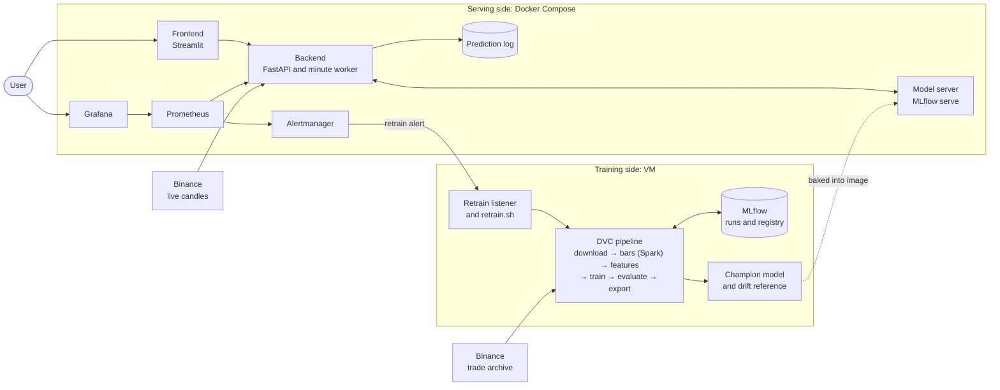

# VolCast

**Next-hour crypto volatility forecasts, updated every minute, with a full MLOps lifecycle running on one machine.**

VolCast forecasts how much the prices of Bitcoin, Ethereum and Solana are likely to move over the next 60 minutes, from live Binance data. Behind the forecast page sits an end-to-end MLOps system: versioned data and pipelines, tracked experiments, a model registry with gated promotion, model serving, monitoring with drift detection, alerting, and automatic retraining.

Built for the AI Operations course at IIT Madras by Rohan Sai P. (DA24B049).

## What it does

- **Forecasts** next-hour realized volatility per coin every minute, shown as an expected % and dollar move with a risk band (Calm, Normal, Elevated, Extreme)
- **Checks itself**: every forecast is scored against what actually happened once its hour has passed
- **Watches for trouble**: latency, data freshness, live accuracy and input drift on a Grafana dashboard, with five alert rules
- **Retrains itself**: sustained poor live accuracy triggers retraining on the latest 92 days; the new model is served only if it beats the current champion on the same test period

## Results

| | Value |
|---|---|
| Champion test QLIKE (lower is better) | 0.197 on its own test period, against HAR 0.280 |
| Baselines on the latest test period | LightGBM 0.259, HAR 0.329, persistence 0.389 |
| Live QLIKE, first days of serving | 0.07 to 0.19 across coins |
| Data pipeline | 552 million trades aggregated with Spark at about 1.6 million trades/s |
| API latency (p95) | about 8 ms |
| Tests | 45 automated tests passing (unit, API, data validation, end to end); `ruff` clean |

## Architecture


 The training side builds and selects the model; the serving side uses it on live data every minute and monitors it. They meet at the exported champion and at the retrain alert.
Full diagram and component list: [docs/architecture.md](docs/architecture.md).

## Quick start

Requires Ubuntu, Python 3.12, uv, Java 17, Docker with Compose, and about 20 GB free disk.

```bash
git clone https://github.com/Rohan-git-iitm/volcast.git && cd volcast
uv venv --python 3.12 && source .venv/bin/activate
uv pip install -r requirements.txt
export MLFLOW_TRACKING_URI=sqlite:///mlflow.db
python -m src.data.roll_window set && dvc repro      # download, build, train, export (15 to 30 min)
docker compose up -d --build
```

Then open `localhost:8501` for forecasts and the pipeline console, and `localhost:3000` for Grafana. Scheduling the daily refresh and the retraining listener is covered in the [user manual](docs/user_manual.md).

## Documentation

| Document | Contents |
|---|---|
| [Project report](volcast_report.pdf) | full write-up: architecture, data, models, MLOps lifecycle, testing, live results|
| [User manual](docs/user_manual.md) | installation, using the pages, demos, operations, troubleshooting |
| [Architecture](docs/architecture.md) | diagram, components, ports, data flows |
| [High-level design](docs/hld.md) | requirements and every design decision with its reasoning |
| [Low-level design](docs/lld.md) | modules, API, schemas, metrics, configuration |
| [Experiments](docs/experiments.md) | ablations and the drift-metric study |
| [Testing](docs/testing.md) | test plan, test cases, test report |
| [AI disclosure](AI_DISCLOSURE.md) | AI tools used and how |


## Tech stack

Python 3.12 · Spark · DVC · MLflow · LightGBM · scikit-learn · FastAPI · Streamlit · Prometheus · Alertmanager · Grafana · Docker Compose · pytest · ruff
