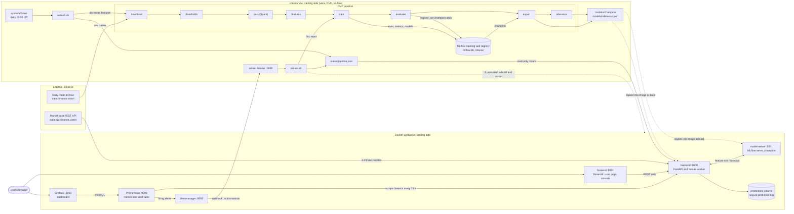

# VolCast architecture

VolCast forecasts the next hour's realized volatility of BTC, ETH and SOL every minute, from live Binance data. It has two sides: a **training side** on the Ubuntu VM (data pipeline, experiments, model registry) and a **serving side** in Docker Compose (model server, backend, frontend, monitoring). They meet in two places only: the exported champion model, and the retraining trigger.

## Diagram

Solid arrows are runtime data flows; dashed arrows happen only when an image is rebuilt.

## Components

| Component | Runs in | Role |
|---|---|---|
| DVC pipeline | VM, venv | Eight versioned stages from raw trades to an exported champion and its drift reference |
| Spark (bars stage) | VM, local mode | Aggregates hundreds of millions of raw trades into 1-minute bars |
| MLflow tracking and registry | VM (`mlflow.db`, `mlruns/`) | Records every training run; the registry holds model versions and the `champion` alias |
| `refresh.sh` + systemd timer | VM | Daily: moves the 92-day window, downloads the new day, rebuilds bars and features |
| Retrain listener + `retrain.sh` | VM | Receives retrain alerts; runs training and the promotion gate; rebuilds containers if a new champion wins |
| model-server | Docker | Serves the exported champion over HTTP (`/invocations`, `/ping`); reachable only inside Docker |
| backend | Docker | Minute worker (candles → features → forecast → log → scoring) and the REST API |
| predictions volume | Docker volume | SQLite log of every forecast and, an hour later, its actual |
| frontend | Docker | User page and pipeline console; talks to the backend only |
| Prometheus | Docker | Scrapes backend metrics, evaluates the five alert rules |
| Alertmanager | Docker | Routes alerts; sends `action=retrain` alerts to the listener |
| Grafana | Docker | Monitoring dashboard, provisioned from files; embedded in the console |

## Ports

| Port | Service | Reachable from |
|---|---|---|
| 8501 | frontend | VM browser |
| 8000 | backend API | VM (frontend, curl, Prometheus) |
| 3000 | Grafana | VM browser |
| 9090 | Prometheus | VM browser |
| 9093 | Alertmanager | VM browser |
| 9095 | retrain listener | Alertmanager, through `host.docker.internal` |
| 5001 | model server | other containers only (not published) |

## The three flows

**1. Data and training (daily, and on retrain).** The timer runs `refresh.sh`, which moves the window to the 92 days ending yesterday, downloads the new day's trades, deletes days outside the window, and runs the pipeline up to `features`. Training waits. On a retrain, `dvc repro` runs `train` (LightGBM against persistence and HAR baselines), `evaluate` (re-scores the champion on the same test period and promotes the challenger only if it wins on QLIKE), `export` (writes the champion to `models/champion`) and `reference` (rebuilds the drift reference only for a new champion).

**2. Serving (every minute).** The backend's worker fetches the newest completed candle per coin from Binance, updates a rolling window, computes features with the same code used in training, sends the latest row to the model server, and stores the forecast. When a forecast's hour has passed, the worker fills in the actual volatility from the same window. The API serves forecasts, history and accuracy from the prediction log, so user requests never wait on Binance or the model.

**3. Monitoring and retraining (continuous).** Prometheus scrapes the backend's metrics: latency, errors, data freshness, forecasts, live QLIKE and RMSPE, and per-feature drift (training percentile of the latest value, and the share of the last 24 hours outside the training 1st to 99th percentile). Grafana draws them. Five alert rules cover a down backend, stale data, worker errors, sustained input drift, and live QLIKE above 1.5 times the test value for 6 hours. The last one carries `action=retrain`, which Alertmanager forwards to the listener, closing the loop.
